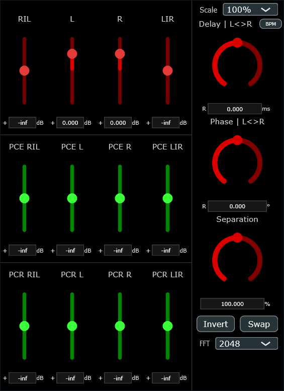

## Description ✏️

**Joiner** is a stereo matrix plugin with some unique features.

### Features ✨

- Multiple independent bipolar crossover channel gain faders for:
  - Original signal
  - Removed `Mid` signal (center)
  - Removed `Side` signal (side)
- Channel delay
- Channel dephasing
- Channel separation
- 16 presets

## Download 📥

1. Clone repository
2. Move files from [`dist`](dist) directory to their appropriate locations

### Special thanks 🤝

- Tom Bertom
- Didier Dambrin

#### Tested on 👨‍💻

| OS Name | OS Version | OS Architecture | Software Name | Software Version | Software Architecture | Plugin Standard | Plugin Architecture |
|:-|:-|:-|:-|:-|:-|:-|:-|
| Windows | 10 21H2 19044.3086 | 64-bit | FL Studio | 26.1.6.5639 | 64-bit | VST3 | 32-bit 64-bit |